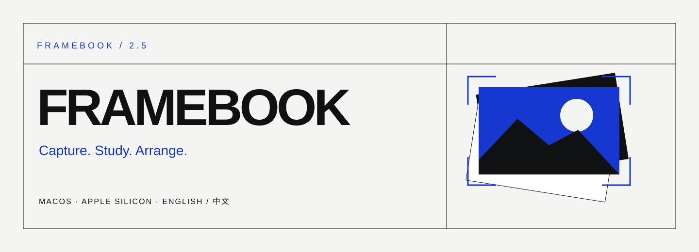
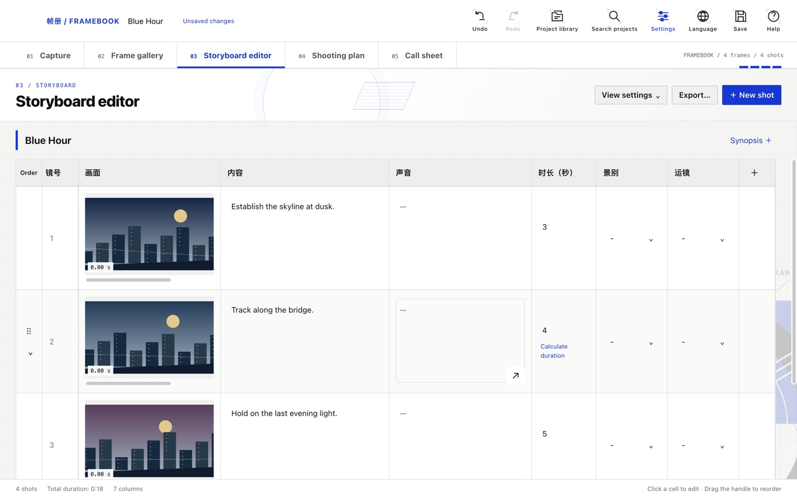
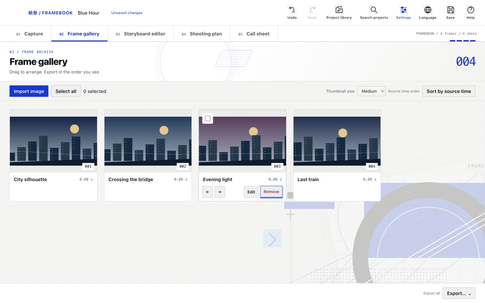
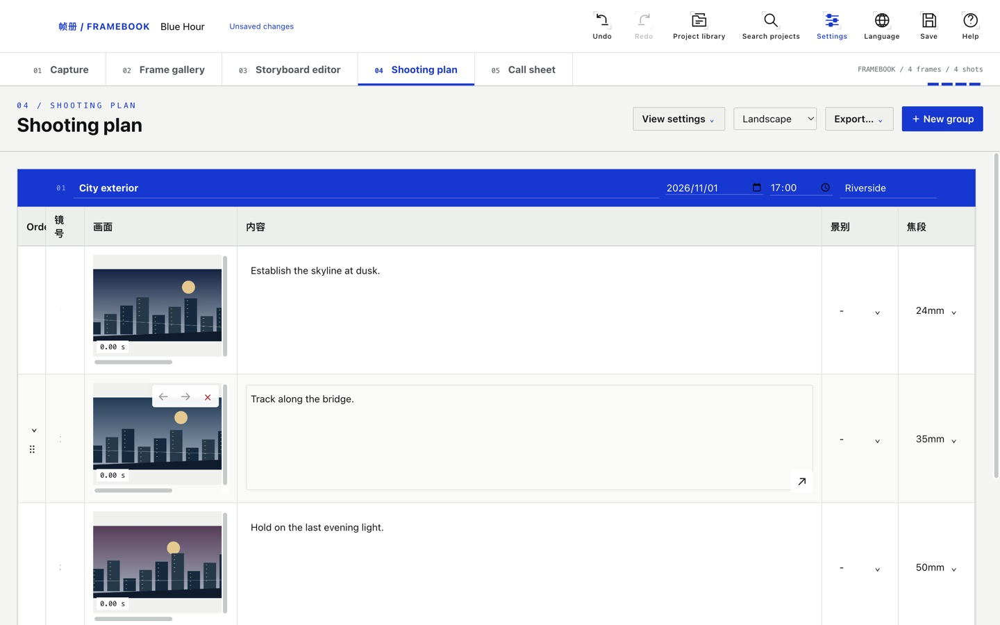

[English](README.md) · [简体中文](README.zh-CN.md)

**A visual workspace for frame analysis, storyboards and shooting preparation on Apple Silicon Mac.**

[Download DMG](https://github.com/ItalyPocket/framebook/releases) · [Report an issue](https://github.com/ItalyPocket/framebook/issues) · [Support the project](docs/SUPPORT.md)

> **Latest release: 2.5.1 · Apple Silicon Mac.** [Download the DMG](https://github.com/ItalyPocket/framebook/releases/tag/v2.5.1). Screenshots below were captured in 2.5.0.

## From reference to shooting plan

**Capture → Gallery → Storyboard → Shooting plan → Call sheet**

Bring in a clip, collect the frames that matter, shape them into shots, and arrange the shoot without losing the visual reference.

| Workspace | What you can do |
| --- | --- |
| Capture | Import or drop MP4/MOV and images; inspect video frame by frame and capture stills. |
| Gallery | Reorder frames, batch-name exports and build single-image or multi-image shots. |
| Storyboard | Edit text, numbers and selectable fields; customize columns and options; calculate shot durations. |
| Shooting plan | Group shots by scene, date/time and location; choose visible columns and arrange shooting order. |
| Call sheet | Keep meeting details, crew, equipment and emergency contacts in a separate workspace. |

## Your shots, your table

Multiple reference images per shot, editable columns and reusable options keep the storyboard close to your process. Storyboard fields stay linked to the shooting plan; production timing is separate from screen duration.



## Collect first, arrange next

The gallery holds your stills before they become a storyboard. Drag files into the app, adjust order, and export a named sequence.



## Prepare the shoot visually

Build scene groups around the same shot references. Each group carries its own date, location and schedule; the plan can show only the fields you need.



*Screenshots show the English 2.5.0 interface with original illustrated demo frames, not user footage. Chinese is also available in the app.*

## Preview, save and move projects

- Preview storyboard PDF/CSV and still exports before confirming. Storyboard PDF supports landscape and portrait A4.
- Return Home to replay the intro and resume your saved project.
- Use the in-app project library, inline project renaming and configurable save/export folders.
- Autosave defaults to 60 seconds with five data recovery copies; both are configurable.
- Imports are copied into the `.sbref` project package by default. External references are optional; ZIP sharing collects linked assets into a portable copy.
- Chinese/English UI, configurable intro/transition effects and reduced-motion support.

Core capture and editing workflows run locally. Optional AI description requires separate credentials and sends selected imagery to its provider. Do not publish private footage or project packages in this source repository.

## Develop

Node.js 22+ and a macOS desktop are required.

```sh
npm ci
npm run dev
```

```sh
npm run typecheck
npm run lint
npm run build
npm run package
```

The Apple Silicon DMG is written to `release/`. FFmpeg is bundled. Current builds are not Apple Developer ID signed or notarized. End-to-end capture tests additionally need `ffmpeg` and `ffprobe` on PATH.

## Support Framebook

Bug reports, clear reproduction steps and translation improvements help the project. Financial sponsorship is **not open yet** while fiscal hosting is being arranged. See [support information](docs/SUPPORT.md); a verified payment link will be added when available.

## Credits and license

Framebook is developed by ItalyPocket from [Storyboard Reference Studio](https://github.com/wassermanproductions/storyboard-reference-studio) by Sam Wasserman. Distributed under Apache-2.0; see [LICENSE](LICENSE) and [NOTICE](NOTICE).
