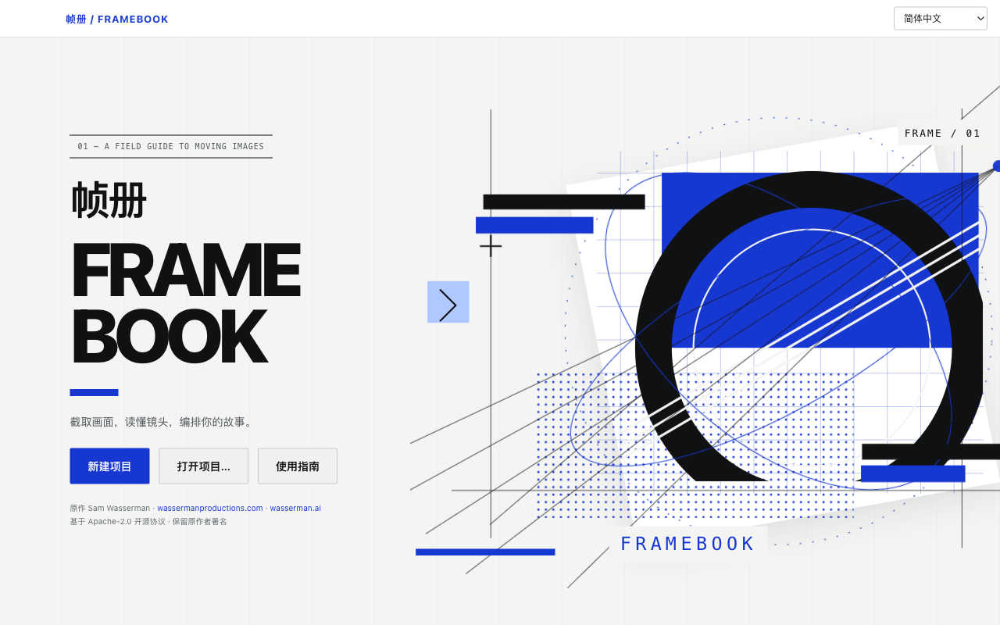
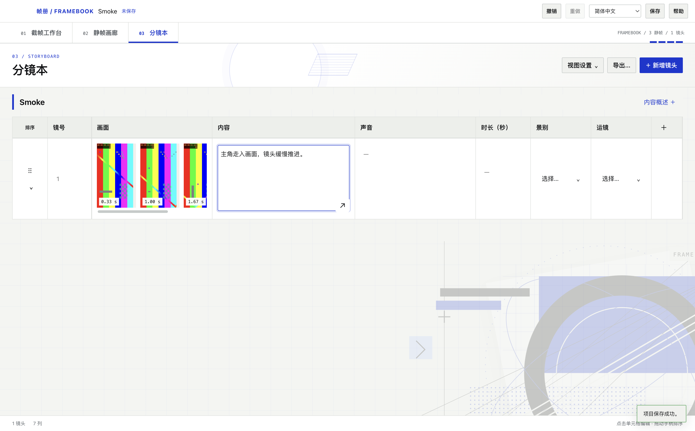

# 帧册 / Framebook

为拉片分析设计的 macOS 静帧与分镜本工具。基于 Sam Wasserman 的 [Storyboard Reference Studio](https://github.com/wassermanproductions/storyboard-reference-studio)，保留 Apache-2.0 许可与原作者署名。

## 2.2 界面

采用冷白、黑色与系统蓝的合成先锋视觉：几何拼贴、网点与轨迹线分层构成，悬停按钮与引导线联动。支持系统“减少动态效果”。分镜表格提供固定表头、拖动排序、列宽调整、三档行高和多图预览；行、列、图片辅助操作在悬停或键盘聚焦时显示。

工作台的素材与设置面板可收起，画廊缩略图大小可调。视图偏好独立保存在本机，不改变项目内容。



## 功能

- 简体中文、English、跟随系统，切换后保存偏好。
- 截帧工作台：导入 MP4 / MOV，逐帧浏览、手动截帧、场景检测、按间隔或数量批量截帧。
- 静帧画廊：默认按素材导入顺序与源时间排序，支持拖动或按钮重排、恢复时间排序、多选、按当前顺序导出 `001.png` / `001.jpg`，附源时间清单。
- 静帧画廊和分镜表格支持 PNG、JPG、HEIC/HEIF、WebP、TIFF、BMP、GIF 图片导入。导入的 HEIF 会生成 PNG 预览副本，源文件保留在项目中。
- 独立分镜本采用表格：默认镜号、画面、内容、声音、时长、景别和运镜；一个镜头可在画面单元格中放入多张图。表头可改名、增删、排序和选择字段类型。
- 常用字段含景别、焦段、机位、运镜和转场，并带有可自定义的选项；支持文本、数字、单选、多选、日期、勾选和图片。
- 时长可直接填写，也可显示入点、出点列后按时间差计算。
- 表头模板保存于本机，可应用、重命名和删除。PDF 与 CSV 按当前可见列和顺序导出。
- 镜头复制、重排、删除、撤销和重做。旧项目字段和图片自动迁移至新版表格。
- 横竖屏保持原比例，支持 9:16、3:4 等裁切。分镜图片保存独立快照，删除画廊静帧不会影响分镜本。
- 保留上游画面标注、演示、动画视频及可选 AI 提示词功能。基础工作流离线可用，AI 生成需要另行配置服务。



## 运行与打包

面向 Apple Silicon（M 系列）Mac。开发需要 Node.js 22+。

```sh
npm ci
npm run dev
```

```sh
npm run typecheck
npm run lint
npm run build
npm run package
```

打包产物位于 `release/`，自带 ffmpeg，无需另装。当前构建没有 Apple Developer ID 签名和公证。

测试使用真实 Electron 和 ffmpeg；测试环境的 PATH 需要有 `ffmpeg`、`ffprobe`。

```sh
npm run e2e
```

## 项目与保存

项目为 `.sbref` 文件夹，包含 `project.json`、复制的媒体、缓存和 `exports/`。请移动整个文件夹。⌘S 保存后会显示保存结果，自动备份每 60 秒写入一次；旧版项目首次保存前会保留 `project.pre-framebook.json`。版本 4 可读取上游版本 1/2/3 项目，并将原有分镜字段和静帧转入表格。

批量截帧单次上限 300 张。长视频或高分辨率素材的处理速度取决于设备。MOV 是容器，具体编码的预览能力取决于 Electron；本版测试覆盖 H.264 的 MP4 / MOV。HDR 色彩管理和专业时间码工作流不属于本版功能。

## 致谢

原作由 **Sam Wasserman** 创建：[wassermanproductions.com](https://wassermanproductions.com) · [wasserman.ai](https://wasserman.ai)。帧册的中文工作流、独立分镜编辑与白蓝视觉改版由 ItalyPocket 定制。完整许可见 [LICENSE](LICENSE)，原作声明见 [NOTICE](NOTICE)。
